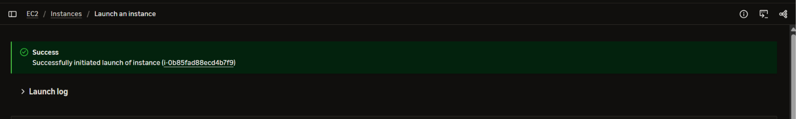
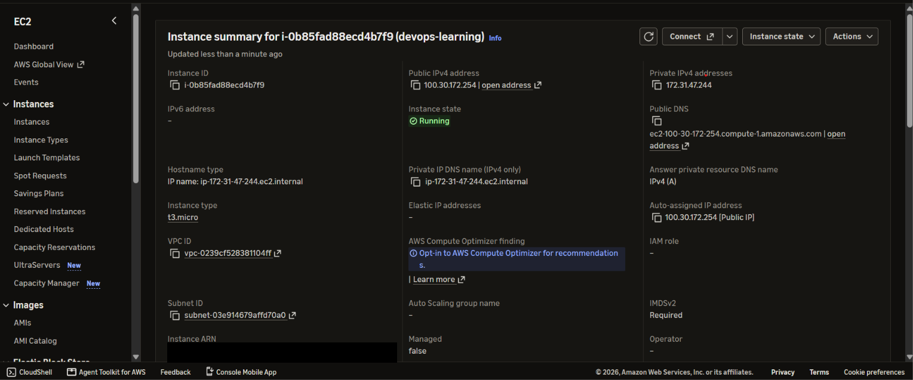
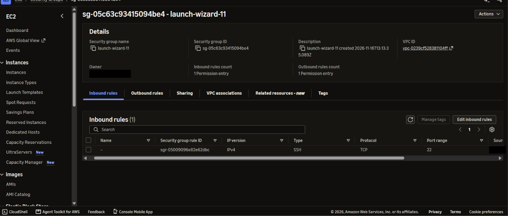
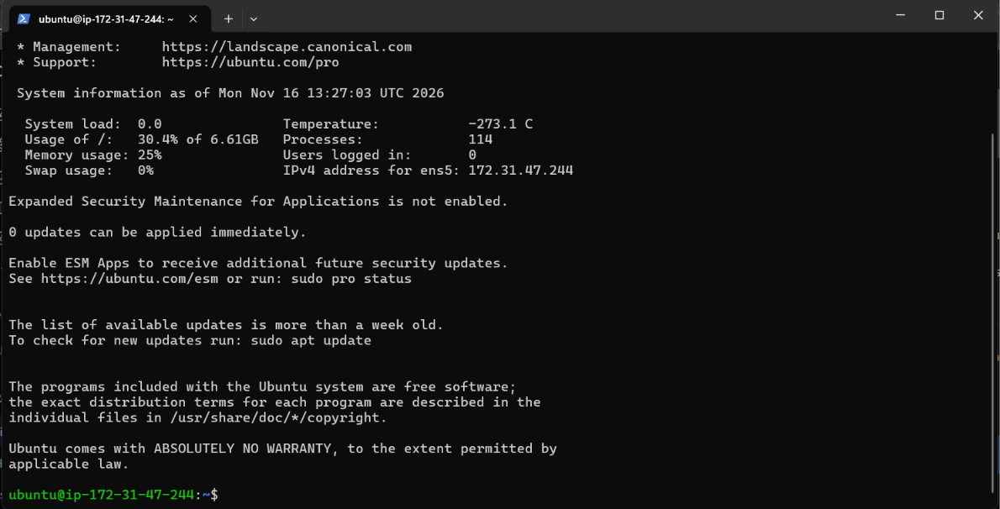
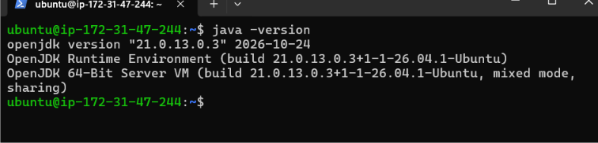
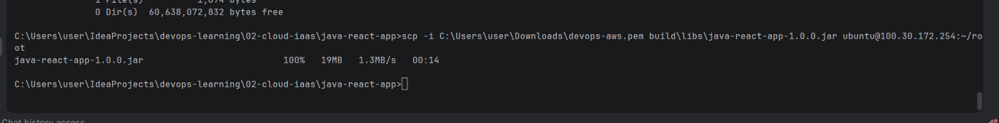
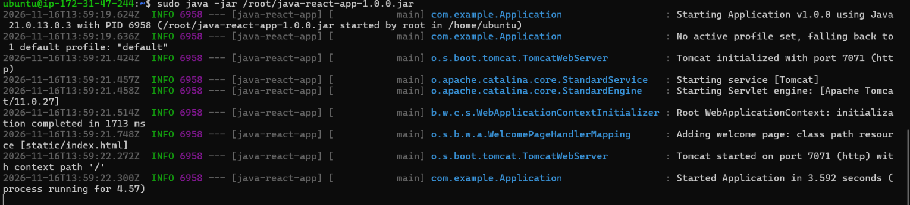
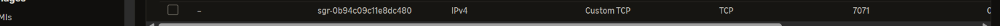
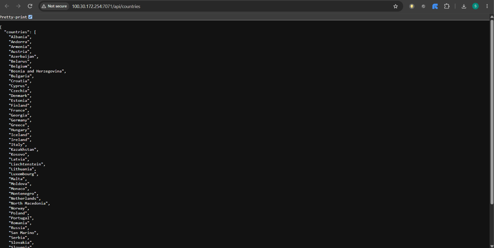

# ☁️ Deploying on AWS


How I launched an Ubuntu EC2 instance, locked it down with a Security Group, deployed
[java-react-app](../java-react-app) on it.

> 🔒 Screenshots have my account ID, email and home IP address blacked out.

---

## 1. Launch the EC2 instance

**AWS Console → EC2 → Launch instance**

| Setting | Value | Why |
|---|---|---|
| Name | `devops-learning` | Easy to find in the list |
| AMI | Ubuntu Server 26.04 LTS | Current long-term-support Ubuntu |
| Instance type | `t3.micro` (2 vCPU, 1 GiB) | Free-tier eligible; enough for one Java app |
| Key pair | new key pair `devops-aws`, type ED25519, `.pem` | Used to log in over SSH |
| Network settings | Allow SSH traffic from **My IP** | Only I can reach port 22 |





## 2. Allow SSH only from my IP

The launch wizard creates a Security Group. I checked that its SSH rule only allows my IP:

**EC2 → Instances → the instance → Security → Security group → Inbound rules**



## 3. Connect over SSH

```bash
ssh -i ~/.ssh/devops-aws.pem ubuntu@<public-ip>
```

> **Windows tip:** if SSH refuses the key with `UNPROTECTED PRIVATE KEY FILE`, remove access for other
> users in PowerShell:
> `icacls devops-aws.pem /inheritance:r /grant:r "$($env:USERNAME):R"`



## 4. Install Java

```bash
sudo apt update
sudo apt install -y openjdk-21-jre-headless
java -version
```



## 5. Build the jar and copy it to the server

On my machine:

```bash
cd 02-cloud-iaas/java-react-app
./gradlew build
scp -i ~/.ssh/devops-aws.pem build/libs/java-react-app-1.0.0.jar ubuntu@<public-ip>:~
```



## 6. Run the app

> In the screenshot I ran the jar in the foreground with `sudo` from `/root`. That works, but the app then
> runs as **root**, and it stops when the SSH session closes. Running it as the normal `ubuntu` user with
> `nohup` (below) is the safer way.

```bash
nohup java -jar java-react-app-1.0.0.jar > app.log 2>&1 &
tail -f app.log            # Ctrl+C to stop watching; the app keeps running
```



## 7. Open port 7071 and view the app in the browser

**Security group → Edit inbound rules → Add rule**: type Custom TCP, port `7071`, source `0.0.0.0/0`
(or My IP to keep it private).



Then open `http://<public-ip>:7071` for the React page, or `http://<public-ip>:7071/api/countries` for the raw API response:



## 8. Clean up 💸

**EC2 → Instances → Instance state → Terminate instance.** Then check **Elastic IPs** and **Volumes** for
anything left over. A stopped instance still pays for its disk.

✅ I terminated the instance once the app was working, so it's no longer running or costing anything.

## 💡 What I learned

**Cloud servers**
- **IaaS gives me the server, not the setup.** AWS runs the hardware, but installing Java, opening ports
  and starting the app were all my job.
- A server only costs money while it exists, so I can launch one, use it, and terminate it the same day.
- **Stop ≠ terminate.** A stopped instance keeps its disk and still costs money. Terminating deletes it all.

**Security**
- **A Security Group is a firewall in front of the instance.** Nothing gets in unless an inbound rule
  allows it.
- **Port 22 should only be open to my own IP** (`x.x.x.x/32`). Port 7071 can be open to `0.0.0.0/0`
  because it's meant to be public.
- **Only open the ports you use.** The launch wizard also opened 80 and 443, which this app doesn't need.
- **The `.pem` key is the only way in.** Windows `ssh` refuses it until other users' access to the file
  is removed.
- **Don't run apps as root.** I first started the jar with `sudo` from `/root`. It worked, but if the app
  were compromised, the attacker would get root access.
- **Screenshots can leak data.** The AWS account ID shows in the instance ARN and as the Security Group
  "Owner", and my home IP shows in the SSH rule, so I blacked them out before publishing.

**Deploying the app**
- **One artifact, one copy.** Because Gradle builds the React frontend into the jar, deploying meant
  copying a single file with `scp`.
- **The server only needs a JRE** (`openjdk-21-jre-headless`). Gradle, Node and the JDK stay on my
  machine.
- **A process started over SSH stops when the session closes**, unless it runs with `nohup ... &`. For
  real deployments this is what systemd services or containers are for.
- **Use the full `http://` address.** The app has no TLS, so an `https://` address won't load. Browsers
  sometimes add `https://` automatically.

